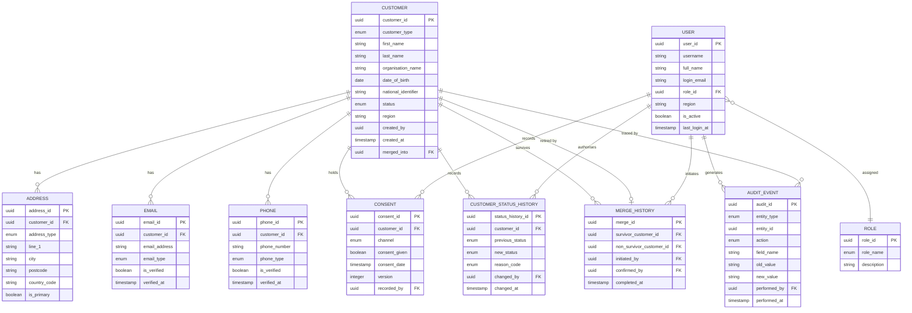

# Data Model — Customer Management Portal

> **AI Agent Note:** This document defines the logical business data model for the Customer Management Portal. Use it to understand what data exists, what values are valid, what combinations are illegal, and what boundaries matter when generating test scenarios or test data. This is not a database schema — it describes business entities and their constraints. Do not infer physical storage details from it.

---

## Entity Overview

| Entity | Purpose |
|---|---|
| Customer | Core record representing a business relationship with an individual or organisation |
| Address | Physical or mailing addresses associated with a customer |
| Email | Email addresses associated with a customer |
| Phone | Phone numbers associated with a customer |
| Consent | Versioned record of a customer's communication consent per channel |
| Customer Status History | Immutable log of every status transition on a customer record |
| Merge History | Record of every merge operation, linking survivor to non-survivor |
| Audit Event | Tamper-proof log of every data change and system action |
| User | Internal staff or system actor who interacts with the portal |
| Role | Named permission set assigned to a User |

---

## 1. Customer

**Purpose:** The central record representing a customer of the organisation. It is the root entity to which all other entities attach. It is the system of record for customer identity and lifecycle state.

**Primary Identifier:** `customer_id`

| Field | Type | Required | Allowed Values / Validation | Business Description | Sensitivity |
|---|---|---|---|---|---|
| `customer_id` | UUID | Yes (system) | System-generated; immutable; unique globally | Permanent unique identifier assigned at creation; never reused | Internal |
| `customer_type` | Enum | Yes | `Individual`, `Organisation` | Determines which fields apply and how identity is verified | Internal |
| `first_name` | String | Yes (Individual) | 1–100 chars; not whitespace-only; not null | Legal first name of the individual | Personal |
| `last_name` | String | Yes (Individual) | 1–150 chars; not whitespace-only; not null | Legal last name of the individual | Personal |
| `organisation_name` | String | Yes (Organisation) | 1–255 chars; not whitespace-only; not null | Registered name of the organisation | Internal |
| `date_of_birth` | Date | Optional (Individual) | Must be in the past; minimum age ≥ 18; format YYYY-MM-DD | Date of birth used for identity verification | Sensitive — Personal |
| `national_identifier` | String | Optional | 5–20 alphanumeric chars; format validated by country code | Government-issued ID (e.g., NI number, tax ID); restricted field | Sensitive — Restricted |
| `status` | Enum | Yes (system) | `Pending`, `Active`, `Suspended`, `Closed`, `Merged` | Current lifecycle state; controlled by permitted transitions only | Internal |
| `region` | String | Yes | Must match a value from the configured region list | Operational region; governs search scope and assignment | Internal |
| `business_unit` | String | Optional | Must match a configured business unit value if provided | Owning business unit within the organisation | Internal |
| `created_by` | User ID | Yes (system) | Must reference a valid User or system identity | Identity of the user or system that created the record | Internal |
| `created_at` | Timestamp | Yes (system) | UTC; must not be in the future; immutable after set | Moment the record was created | Internal |
| `updated_at` | Timestamp | Yes (system) | UTC; must be ≥ `created_at` | Moment the record was last modified | Internal |
| `merged_into` | Customer ID | Conditional | Required if `status = Merged`; must reference a surviving record; null otherwise | Reference to the surviving customer record after a merge | Internal |

**Unique Constraints:**
- `national_identifier` must be unique across all records where `status` is not `Merged` or `Closed` (when provided).

**Important Notes:**
- `first_name` + `last_name` apply only when `customer_type = Individual`.
- `organisation_name` applies only when `customer_type = Organisation`.
- `merged_into` must be null for all statuses except `Merged`.

---

## 2. Address

**Purpose:** Physical or mailing addresses associated with a customer. A customer may have multiple addresses; one must be designated as primary.

**Primary Identifier:** `address_id`

| Field | Type | Required | Allowed Values / Validation | Business Description | Sensitivity |
|---|---|---|---|---|---|
| `address_id` | UUID | Yes (system) | System-generated; unique globally | Unique identifier for the address record | Internal |
| `customer_id` | Customer ID | Yes | Must reference an existing Customer | Link to the owning customer | Internal |
| `address_type` | Enum | Yes | `Primary`, `Billing`, `Mailing`, `Secondary` | Classification of the address purpose | Internal |
| `line_1` | String | Yes | 1–255 chars; not whitespace-only | First line of the address | Personal |
| `line_2` | String | Optional | 0–255 chars | Second line of the address (flat number, building name, etc.) | Personal |
| `city` | String | Yes | 1–100 chars | City or town | Personal |
| `county_state` | String | Optional | 0–100 chars | County, state, or province | Personal |
| `postcode` | String | Yes | Format validated against `country_code` format rules | Postal or ZIP code | Personal |
| `country_code` | String | Yes | ISO 3166-1 alpha-2 (e.g., `GB`, `US`, `IE`) | Country; governs postcode format validation | Personal |
| `is_primary` | Boolean | Yes | `true` or `false` | Designates whether this is the customer's primary address; exactly one `Primary` type may exist | Internal |
| `created_at` | Timestamp | Yes (system) | UTC | When the address was added | Internal |
| `updated_at` | Timestamp | Yes (system) | UTC; ≥ `created_at` | When the address was last modified | Internal |

**Unique Constraints:**
- Exactly one address per customer may have `address_type = Primary`.

**Referential Rules:**
- Deleting a customer does not delete addresses; they are retained for audit.
- An address cannot exist without a valid parent `customer_id`.

---

## 3. Email

**Purpose:** Email addresses associated with a customer. Used for communication, identity verification, and duplicate detection.

**Primary Identifier:** `email_id`

| Field | Type | Required | Allowed Values / Validation | Business Description | Sensitivity |
|---|---|---|---|---|---|
| `email_id` | UUID | Yes (system) | System-generated; unique globally | Unique identifier for this email record | Internal |
| `customer_id` | Customer ID | Yes | Must reference an existing Customer | Link to the owning customer | Internal |
| `email_address` | String | Yes | RFC 5321 format; max 254 chars; lowercase on save | The email address value | Personal |
| `email_type` | Enum | Yes | `Primary`, `Secondary` | Whether this is the main or an additional address | Internal |
| `is_verified` | Boolean | Yes | `true` or `false`; default `false` | Whether the address has been confirmed deliverable | Internal |
| `verified_at` | Timestamp | Conditional | Required if `is_verified = true`; UTC | When verification was completed | Internal |
| `created_at` | Timestamp | Yes (system) | UTC | When this email record was created | Internal |

**Unique Constraints:**
- `email_address` must be unique across all customers where `status` is `Active` or `Pending` for records where `email_type = Primary`.

**Referential Rules:**
- A customer transitioning to `Active` must have at least one email or phone record that is verified.

---

## 4. Phone

**Purpose:** Phone numbers associated with a customer. Used for contact, verification, and duplicate detection.

**Primary Identifier:** `phone_id`

| Field | Type | Required | Allowed Values / Validation | Business Description | Sensitivity |
|---|---|---|---|---|---|
| `phone_id` | UUID | Yes (system) | System-generated; unique globally | Unique identifier for this phone record | Internal |
| `customer_id` | Customer ID | Yes | Must reference an existing Customer | Link to the owning customer | Internal |
| `phone_number` | String | Yes | E.164 format; e.g., `+441234567890`; max 15 digits | The phone number; normalised to E.164 on save | Personal |
| `phone_type` | Enum | Yes | `Primary`, `Mobile`, `Work`, `Secondary` | Classification of the phone number | Internal |
| `is_verified` | Boolean | Yes | `true` or `false`; default `false` | Whether the number has been confirmed reachable | Internal |
| `verified_at` | Timestamp | Conditional | Required if `is_verified = true`; UTC | When verification was completed | Internal |
| `created_at` | Timestamp | Yes (system) | UTC | When this phone record was created | Internal |

**Unique Constraints:**
- `phone_number` must be unique across all customers where `status` is `Active` or `Pending` for records where `phone_type = Primary`.

---

## 5. Consent

**Purpose:** Versioned record of a customer's communication consent per channel. Each change in consent state creates a new record; existing records are never overwritten.

**Primary Identifier:** `consent_id`

| Field | Type | Required | Allowed Values / Validation | Business Description | Sensitivity |
|---|---|---|---|---|---|
| `consent_id` | UUID | Yes (system) | System-generated; unique globally | Unique identifier for this consent version | Internal |
| `customer_id` | Customer ID | Yes | Must reference an existing Customer | Link to the owning customer | Internal |
| `channel` | Enum | Yes | `Email`, `Phone`, `SMS`, `Post` | The communication channel this consent applies to | Internal |
| `consent_given` | Boolean | Yes | `true` = consent granted; `false` = consent withheld or withdrawn | Whether consent is active for this channel | Sensitive — Compliance |
| `consent_date` | Timestamp | Yes | UTC; must be ≤ current time | When this consent state was recorded | Sensitive — Compliance |
| `withdrawn_date` | Timestamp | Conditional | Required when recording a withdrawal; UTC; must be > `consent_date` | When consent was withdrawn for this version | Sensitive — Compliance |
| `version` | Integer | Yes (system) | Monotonically incrementing per `customer_id` + `channel` | Version number of this consent record within the customer-channel sequence | Internal |
| `recorded_by` | User ID | Yes | Must reference a valid User | User who recorded this consent change | Internal |

**Unique Constraints:**
- The current (latest) consent version per `customer_id` + `channel` combination determines the effective consent state.

**Referential Rules:**
- Consent records are never deleted or overwritten. A new record is always inserted to change consent state.
- The communications platform reads the latest `consent_given` value per channel before sending any outbound message.

---

## 6. Customer Status History

**Purpose:** Immutable log of every status transition that has occurred on a customer record. Used for lifecycle auditing, dispute resolution, and compliance reporting.

**Primary Identifier:** `status_history_id`

| Field | Type | Required | Allowed Values / Validation | Business Description | Sensitivity |
|---|---|---|---|---|---|
| `status_history_id` | UUID | Yes (system) | System-generated; unique globally | Unique identifier for this history entry | Internal |
| `customer_id` | Customer ID | Yes | Must reference an existing Customer | Link to the customer whose status changed | Internal |
| `previous_status` | Enum | Conditional | Same allowed values as `Customer.status`; null only on first transition from creation | The status before this transition | Internal |
| `new_status` | Enum | Yes | `Pending`, `Active`, `Suspended`, `Closed`, `Merged` | The status after this transition | Internal |
| `reason_code` | Enum | Conditional | Required for transitions to `Suspended` and `Closed`; from configured reason code list | Standardised reason for the transition | Internal |
| `notes` | String | Optional | 0–1000 chars | Free-text notes provided by the authorising user | Internal |
| `changed_by` | User ID | Yes | Must reference a valid User or system identity | Who authorised and executed the transition | Internal |
| `changed_at` | Timestamp | Yes (system) | UTC; immutable | When the transition occurred | Internal |

**Referential Rules:**
- Entries are never edited or deleted.
- `new_status` must be a permitted transition from `previous_status` per the allowed transition matrix (see BR-016).

---

## 7. Merge History

**Purpose:** Permanent record of every merge operation, linking the non-surviving record to the surviving record. Required for audit, traceability, and downstream reconciliation.

**Primary Identifier:** `merge_id`

| Field | Type | Required | Allowed Values / Validation | Business Description | Sensitivity |
|---|---|---|---|---|---|
| `merge_id` | UUID | Yes (system) | System-generated; unique globally | Unique identifier for this merge event | Internal |
| `survivor_customer_id` | Customer ID | Yes | Must reference a Customer that remains Active after the merge | The canonical record that continues to exist | Internal |
| `non_survivor_customer_id` | Customer ID | Yes | Must reference a Customer that transitions to `Merged`; distinct from `survivor_customer_id` | The record that is retired | Internal |
| `initiated_by` | User ID | Yes | Must reference a User with Supervisor role or above | User who started the merge workflow | Internal |
| `confirmed_by` | User ID | Yes | Must reference a User with Supervisor role or above; may be same as `initiated_by` | User who confirmed and completed the merge | Internal |
| `initiated_at` | Timestamp | Yes (system) | UTC | When the merge was started | Internal |
| `completed_at` | Timestamp | Yes (system) | UTC; must be ≥ `initiated_at` | When the merge was completed | Internal |
| `merge_notes` | String | Optional | 0–2000 chars | Rationale or observations recorded by the Supervisor | Internal |

**Unique Constraints:**
- `non_survivor_customer_id` must appear as a non-survivor in at most one Merge History record (a record can only be merged once).
- `survivor_customer_id` and `non_survivor_customer_id` must be different values.

**Referential Rules:**
- After merge completes, the non-survivor's `Customer.status` is set to `Merged` and `Customer.merged_into` is set to `survivor_customer_id`.
- Merge History records are never deleted or modified.

---

## 8. Audit Event

**Purpose:** Tamper-proof, system-generated record of every create, update, status change, merge, and access event. The authoritative record for compliance and forensic inquiry.

**Primary Identifier:** `audit_id`

| Field | Type | Required | Allowed Values / Validation | Business Description | Sensitivity |
|---|---|---|---|---|---|
| `audit_id` | UUID | Yes (system) | System-generated; unique globally | Unique identifier for this audit entry | Internal |
| `entity_type` | Enum | Yes | `Customer`, `Address`, `Email`, `Phone`, `Consent`, `MergeHistory`, `User`, `Role` | The type of entity that was affected | Internal |
| `entity_id` | UUID | Yes | Must reference the affected entity's identifier | Identifier of the specific entity that changed | Internal |
| `action` | Enum | Yes | `CREATE`, `UPDATE`, `STATUS_CHANGE`, `MERGE`, `DELETE`, `LOGIN`, `LOGOUT`, `PERMISSION_CHANGE` | Category of action that occurred | Internal |
| `field_name` | String | Conditional | Required for `UPDATE` actions; name of the changed field | Which field was changed | Internal |
| `old_value` | String | Conditional | Present for `UPDATE` and `STATUS_CHANGE`; serialised previous value; null for `CREATE` | Value before the change | Sensitive — may contain Personal data |
| `new_value` | String | Conditional | Present for `UPDATE`, `CREATE`, and `STATUS_CHANGE`; serialised new value | Value after the change | Sensitive — may contain Personal data |
| `performed_by` | User ID | Yes | Must reference a valid User ID or a system integration identity | Who or what performed the action | Internal |
| `performed_at` | Timestamp | Yes (system) | UTC; immutable | When the action occurred | Internal |
| `source_ip` | String | Optional | IPv4 or IPv6 format | Network address from which the action originated | Internal |

**Referential Rules:**
- Audit Event records cannot be created, modified, or deleted by any user role. They are system-generated only.
- Audit records are retained indefinitely (see BR-046).
- `old_value` and `new_value` store serialised representations; sensitive values should be flagged for restricted access in reporting contexts.

---

## 9. User

**Purpose:** Represents an internal staff member, administrator, or system integration account that can interact with the Customer Management Portal.

**Primary Identifier:** `user_id`

| Field | Type | Required | Allowed Values / Validation | Business Description | Sensitivity |
|---|---|---|---|---|---|
| `user_id` | UUID | Yes (system) | System-generated; unique globally | Unique identifier for this user | Internal |
| `username` | String | Yes | 3–50 chars; alphanumeric and underscores only; unique globally | Login username | Internal |
| `full_name` | String | Yes | 1–200 chars; not whitespace-only | Display name of the user | Personal |
| `login_email` | String | Yes | RFC 5321 format; unique globally | Email address used for authentication and notifications | Personal |
| `role_id` | Role ID | Yes | Must reference a valid Role | The role that governs this user's permissions | Internal |
| `region` | String | Yes | Must match a configured region value | Determines the scope of data this user can access | Internal |
| `business_unit` | String | Optional | Must match a configured value if provided | Operational unit of the user | Internal |
| `is_active` | Boolean | Yes | `true` or `false`; default `true` | Whether this user account is enabled | Internal |
| `last_login_at` | Timestamp | Optional | UTC; updated on each successful login | Timestamp of most recent successful authentication | Internal |
| `created_at` | Timestamp | Yes (system) | UTC | When the user account was created | Internal |

**Unique Constraints:**
- `username` must be unique across all User records.
- `login_email` must be unique across all User records.

**Referential Rules:**
- A User must always have exactly one Role assigned.
- Deactivating a user (`is_active = false`) does not delete their audit history or any records they created.

---

## 10. Role

**Purpose:** A named permission set that defines what actions a User is authorised to perform within the portal.

**Primary Identifier:** `role_id`

| Field | Type | Required | Allowed Values / Validation | Business Description | Sensitivity |
|---|---|---|---|---|---|
| `role_id` | UUID | Yes (system) | System-generated; unique globally | Unique identifier for the role | Internal |
| `role_name` | Enum | Yes | `Viewer`, `Agent`, `Supervisor`, `Administrator`, `System` | The canonical name of the role | Internal |
| `description` | String | Yes | 1–500 chars | Human-readable description of the role's purpose and scope | Internal |
| `created_at` | Timestamp | Yes (system) | UTC; immutable | When the role was defined | Internal |

**Unique Constraints:**
- `role_name` must be unique. Exactly five roles exist; no custom roles are supported.

**Role Capability Summary:**

| Role | Create Customer | Edit Customer | Status Change | Merge | Admin Config | Restricted Fields |
|---|---|---|---|---|---|---|
| Viewer | No | No | No | No | No | Hidden |
| Agent | Yes | Yes (Active only) | Pending→Active | No | No | Hidden |
| Supervisor | Yes | Yes | All permitted | Yes | No | Visible |
| Administrator | Yes | Yes | All permitted | Yes | Yes | Visible |
| System | Yes | Yes | All permitted | Yes | No | Visible |

---

## Entity Relationships

| Relationship | Cardinality | Rule |
|---|---|---|
| Customer → Address | One-to-many | A customer may have zero or more addresses; at most one may be `Primary` |
| Customer → Email | One-to-many | A customer may have one or more emails; at most one may be `Primary` |
| Customer → Phone | One-to-many | A customer may have one or more phones; at most one may be `Primary` |
| Customer → Consent | One-to-many | A customer has one consent record per channel; each change adds a new version |
| Customer → Customer Status History | One-to-many | Every status transition creates one history record; no transition deletes one |
| Customer → Merge History (survivor) | One-to-many | A customer may survive multiple merges over its lifetime |
| Customer → Merge History (non-survivor) | One-to-one | A customer can be the non-survivor of at most one merge |
| Customer → Audit Event | One-to-many | Every change to a customer or its child entities produces one or more audit events |
| User → Role | Many-to-one | Each user has exactly one role; many users may share a role |
| User → Audit Event | One-to-many | Every action by a user produces at least one audit event |
| User → Customer Status History | One-to-many | A user may authorise many status transitions |
| User → Merge History | One-to-many | A user may initiate or confirm many merges |
| User → Consent | One-to-many | A user records many consent changes across customers |

---

## Entity Relationship Diagram

---

## Important Test-Data Boundaries

| Entity | Field | Boundary Condition | Expected Behaviour |
|---|---|---|---|
| Customer | `first_name` | Empty string or whitespace only | Rejected — BR-048 |
| Customer | `first_name` | Exactly 100 characters | Accepted |
| Customer | `first_name` | 101 characters | Rejected |
| Customer | `date_of_birth` | Today's date | Rejected — must be in the past |
| Customer | `date_of_birth` | Age = 17 years | Rejected — minimum age 18 |
| Customer | `date_of_birth` | Age = 18 years | Accepted |
| Customer | `national_identifier` | 4 characters | Rejected — minimum 5 |
| Customer | `national_identifier` | 20 characters | Accepted |
| Customer | `national_identifier` | 21 characters | Rejected — maximum 20 |
| Customer | `status` | Any transition not in BR-016 matrix | Rejected with business reason |
| Email | `email_address` | Missing `@` symbol | Rejected — invalid format |
| Email | `email_address` | 255 characters (exceeds 254) | Rejected |
| Email | `email_address` | Uppercase characters | Accepted — normalised to lowercase on save |
| Phone | `phone_number` | Without `+` country prefix | Rejected or normalised depending on input mode |
| Phone | `phone_number` | Fewer than 7 digits after country code | Rejected |
| Phone | `phone_number` | More than 15 digits (E.164 max) | Rejected |
| Address | `postcode` | Format mismatch for `country_code` | Rejected |
| Address | `country_code` | Value not in ISO 3166-1 alpha-2 | Rejected |
| Consent | `withdrawn_date` | Earlier than `consent_date` | Rejected — chronologically invalid |
| Consent | `version` | Attempt to decrement or skip a version | Rejected — system-managed only |
| Merge History | `survivor_customer_id` | Same value as `non_survivor_customer_id` | Rejected — cannot merge a record with itself |
| User | `username` | Fewer than 3 characters | Rejected |
| User | `username` | Contains a space or special character | Rejected |
| User | `login_email` | Duplicate of an existing user's email | Rejected — uniqueness constraint |

---

## Invalid Data Combinations

| Combination | Why Invalid | Relevant Rule |
|---|---|---|
| `customer_type = Individual` with `organisation_name` populated | Organisation name does not apply to individuals | BR-001 |
| `customer_type = Organisation` with `date_of_birth` populated | Date of birth does not apply to organisations | BR-001 |
| `status = Active` with no verified email or phone | Active customers must have at least one verified contact method | BR-023 |
| `status = Merged` with `merged_into = null` | A merged record must reference its survivor | BR-010 |
| `status = Closed` with open service cases or outstanding balance | Closure is blocked by open obligations | BR-017 |
| `status = Closed` followed by any further status transition | Closed is a terminal state | BR-019 |
| `is_verified = true` with `verified_at = null` | Verification timestamp must accompany verified status | Email / Phone entity rules |
| `email_type = Primary` on two email records for the same customer | Only one primary email permitted per customer | Email uniqueness constraint |
| `phone_type = Primary` on two phone records for the same customer | Only one primary phone permitted per customer | Phone uniqueness constraint |
| Two addresses with `address_type = Primary` for the same customer | Only one primary address permitted per customer | Address uniqueness constraint |
| `consent_given = false` with no `withdrawn_date` | Withdrawal of consent must record when it occurred | Consent entity rules |
| `Merge History` where `non_survivor_customer_id` already has a Merge History entry | A record can only be merged once | BR-036 |
| `User.role_id` = Viewer attempting a `CREATE` action | Viewers do not have creation permission | BR-038 |
| `User` modifying their own `role_id` | Self-assignment of permissions is prohibited | BR-042 |
| Audit Event with `action = UPDATE` and `field_name = null` | Field name is required for update audit entries | BR-043 |
| `Customer.merged_into` referencing a `Merged` or `Closed` record | The merge target must be an Active survivor | Merge referential rules |
